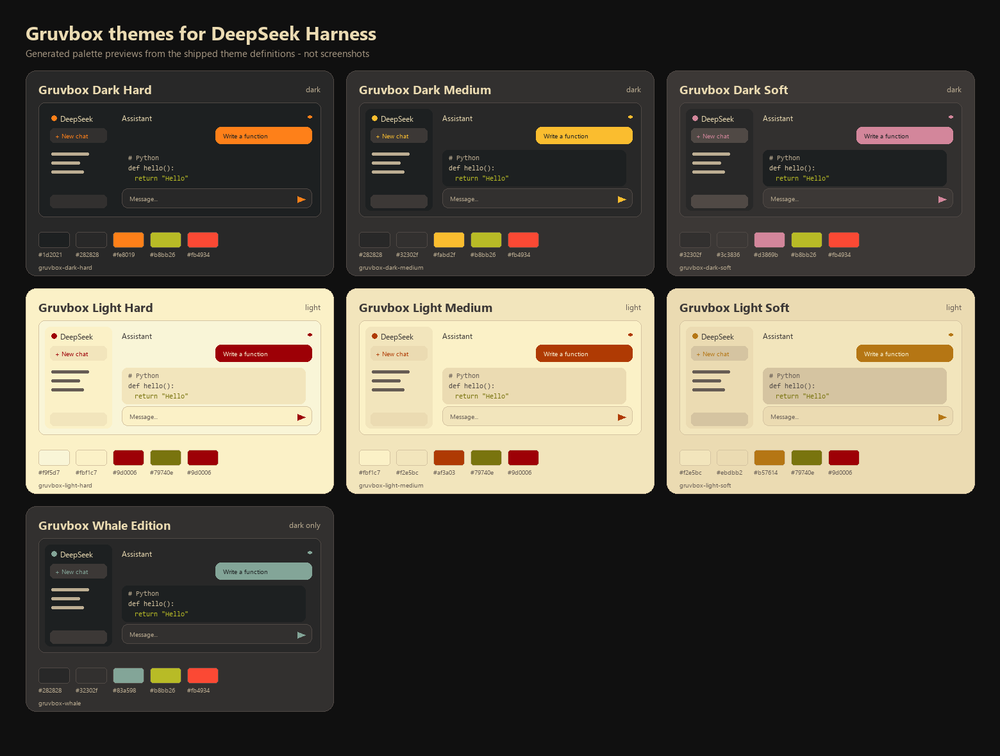

# deepseek-gruvbox-themes

[](https://github.com/kuzmin-lemmi/deepseek-gruvbox-themes/actions/workflows/ci.yml)

Seven Gruvbox themes for [DeepSeek Harness](https://github.com/deepseek-ai/deepseek-harness), with a preview picker in **Settings → General**, a saved selection, automatic light/dark following, and a small agent tool for switching themes from chat.



> The image above is generated from the same palette data the plugin registers. It is an illustration, not a screenshot of the running application.

## What you get

| Id                       | Scheme | Base      | Accent    |
| ------------------------ | ------ | --------- | --------- |
| `gruvbox-dark-hard`      | dark   | `#1d2021` | `#fe8019` |
| `gruvbox-dark-medium`    | dark   | `#282828` | `#fabd2f` |
| `gruvbox-dark-soft`      | dark   | `#32302f` | `#d3869b` |
| `gruvbox-light-hard`     | light  | `#f9f5d7` | `#9d0006` |
| `gruvbox-light-medium`   | light  | `#fbf1c7` | `#af3a03` |
| `gruvbox-light-soft`     | light  | `#f2e5bc` | `#b57614` |
| `gruvbox-whale`          | dark   | `#282828` | `#83a598` |

Every theme overrides **130 tokens**: backgrounds and surfaces, the sidebar, borders, primary through caption text, brand and buttons, interaction states, success/warning/error/business states, menus, composer, scrollbars, Markdown and diff colors, the Shiki syntax variables, and terminal colors through `--dsw-alias-bg-base` / `--dsw-alias-label-primary`.

The accent is wired where it reads as identity rather than noise: links, keyboard focus rings, `@` reference chips, the active settings row, and settings-card borders. Large surfaces stay neutral.

The picker adds a **Gruvbox themes** row with a live preview card per theme (each card is drawn with that theme's own colors), a **Follow system appearance** switch, and a **Use standard theme** reset.

Switching is a 180 ms cross-fade when the engine supports view transitions. The new palette is installed before the base scheme flips, so a light↔dark switch never paints the old light tokens on a dark canvas, and an in-flight settings echo cannot revert the choice halfway through the write.

## Compatibility and API basis

Built and verified against the installed **DeepSeek Harness `0.2.2-rc.1`** (Client UI theme). The implementation uses only documented extension points:

- `ctx.theme.getTheme()`, `ctx.theme.setTheme()`, and `ctx.theme.overrideTokens()` from `@deepseek-ai/dsh-client-ui-theme`.
- `ctx.configForms.get(entryId)` from `@deepseek-ai/dsh-client-ui-settings` for reading and writing the profile selection.
- A Host row with a [schemastery](https://github.com/deepseek-ai/deepseek-harness/tree/master/vendor/schemastery) `Config` whose fields are `.volatile()`, served by the Host settings service.
- `webserver/index-inject` for the pre-plugin background/scheme paint.
- `ctx.tools.register()` for the optional `gruvbox_theme` agent tool.

No browser storage is used, no profile file is edited directly, and no DeepSeek Harness source is modified.

### Why the plugin uses a token layer, not a new theme id

The installed theme service persists only `light`, `dark`, and `system` in `ui-theme.preference`; a third-party theme id is an in-process value. The service also reconciles its own settings on profile updates, which can replace an in-process third-party id. Registering seven third-party ids would therefore make the selection revert on the next settings write.

This plugin instead keeps the **built-in base preference** (`light`/`dark`/`system`) and stacks the Gruvbox palette through `ctx.theme.overrideTokens()`. The durable choice (`theme` and `followSystem`) lives in this plugin's own settings entry. The result:

- colors survive settings writes and restarts;
- `followSystem` sets the base preference to `system`; the Host flips the scheme and the layer already carries both palettes;
- the built-in Appearance row keeps working, and choosing a different value there leaves the Gruvbox layer.

## Install

The plugin installs through the plugin manager, which runs the equivalent of:

```sh
dsh plugin --profile desktop add ./deepseek-gruvbox-themes
```

Other supported forms:

```sh
# from GitHub
dsh plugin --profile desktop add github:kuzmin-lemmi/deepseek-gruvbox-themes

# from a local checkout
dsh plugin --profile desktop add ./deepseek-gruvbox-themes

# after the package is published to npm
dsh plugin --profile desktop add deepseek-gruvbox-themes
```

`web` is the shipped Web profile; use your profile name in place of `desktop` when needed. The package ships a bundle manifest (`dsh.bundle.patch`) and a browser half (`dsh.client`), so `dsh plugin` wires both sides.

To remove it:

```sh
dsh plugin --profile desktop remove deepseek-gruvbox-themes
```

### Manual install

If you manage the profile yourself, add the bundle to the profile's dependency list and restart the host. The bundle patch inserts the row:

```yaml
- insert:
    - id: deepseek-gruvbox-themes
      name: deepseek-gruvbox-themes
```

## Use

1. Open **Settings** (the gear at the sidebar foot).
2. Open **General** and find **Gruvbox themes**, right after the host Appearance row.
3. Click a card. The application retints immediately; the card shows a ring and a check mark.
4. Toggle **Follow system appearance** to switch between the light and dark member of the selected family when the operating system scheme changes. Whale Edition has no light counterpart and stays dark.
5. Use **Use standard theme** to remove the Gruvbox layer and return to the built-in theme.

Saving starts as soon as you click; the row reports `Saving…`, `Saved`, or a concrete failure. A profile that refuses settings writes shows a read-only message and keeps the theme for the current session only.

### Persistence

The selection is stored in the profile's settings document as a row of this plugin:

```yaml
- id: deepseek-gruvbox-themes
  name: deepseek-gruvbox-themes
  config:
    theme: gruvbox-dark-medium
    followSystem: false
```

In addition, applying a fixed theme sets the built-in `ui-theme.preference` to its matching `light` or `dark` value, so native controls and the `data-ds-dark-theme` attribute agree with the palette. `followSystem` sets it to `system`.

Nothing is kept in `localStorage`, cookies, or an external service.

## Agent tool

The Host half registers `gruvbox_theme`:

```json
{ "action": "status" }
{ "action": "list" }
{ "action": "set", "theme": "gruvbox-dark-soft", "followSystem": true }
{ "action": "reset" }
```

`set` and `reset` write the same settings fields as the picker, so a change from chat reaches connected Web clients through the settings document and persists. Invalid theme ids and read-only profiles return an explicit failure instead of claiming success.

## Token coverage

`cordis_inspect_query` (`Theme.listTokens`) reports 14 theme-overridable alias tokens on this build; all of them are covered. The layer also sets the wider alias set the shipped stylesheets consume:

- surfaces: `bg-base`, `bg-layer-1..3`, `bg-overlay`, `bg-module-platform`, `bg-skeleton`, masks, multi-select, document preview;
- sidebar: `specific-sidebar-fill`, `specific-sidebar-nav-item-active`, `-active-accent`;
- borders: `border-l1..l4`, inverted borders;
- text: primary, secondary, tertiary, caption, dimmed, inverted, shimmer;
- brand, links, buttons (primary, contrast, elevated, floating, ghost, info, toolbar);
- interaction: hover, active, accent/danger hovers;
- states: success, warning, error, idle, business, done (primary/secondary/tertiary where the alias exists);
- menus, toast, tooltip, switch, turn trigger, settings cards, scrollbars;
- component card surfaces: the static `neutral-50/100/850/800` fills used by the changed-files, deliverables, plan, and schedule cards, whose defaults are near-white in a light theme;
- Markdown code block, banner, inline code, citation, segment selection, diff colors;
- Shiki: `--shiki-foreground`, `--shiki-background`, and every `--shiki-token-*` color.

Terminal: the sidebar terminal derives its foreground, background, cursor, and selection colors from computed styles, so the theme's `bg-base` and `label-primary` apply. Its ANSI color table is supplied by the terminal component (xterm), not by design tokens, so those sixteen ANSI colors do not change per theme. This is a Harness limitation, not a missing token.

## Development

Requirements: Node.js 20+ for the build and Node.js 22.6+ to run the TypeScript tests directly (Node 24 is what this repository was built with).

```sh
pnpm install
pnpm run typecheck
pnpm test
pnpm run build
pnpm run previews       # regenerates docs/previews/*.svg and the gallery
pnpm run previews:png   # additionally renders the contact sheet with Pillow
```

`pnpm run build` writes both artifacts:

- `lib/index.js` — Host half, ESM, schemastery bundled in, zero runtime dependencies;
- `lib/client.js` — browser half in the Harness module-loader factory format, React external.

The tests cover the official palette anchors, required token coverage, WCAG contrast for text and state colors, the selection model, the light/dark override builder, and the pre-plugin boot rows.

### Project layout

```
src/shared/     palette, theme definitions, selection rules, boot injection
src/host/       Config, settings policy, index injection, gruvbox_theme tool
src/client/     override layer, saved selection, picker row, styles, locale
test/           node:test unit tests
scripts/        esbuild build, SVG previews, PNG contact sheet
docs/previews/  generated previews
```

## Known limitations

- **Visual verification was not available in this environment.** There is no browser-control tool here, so the row's rendering and the live color change were verified through the registered slot entry, the applied settings values, the agent tool, and generated previews rather than a screenshot. Open Settings → General once to confirm the row visually.
- The plugin changes the built-in Appearance preference to match the chosen scheme. Picking a different value in the built-in Appearance row exits the Gruvbox theme; the picker then shows the standard theme.
- Another plugin that stacks a later token override can win over this layer. Layer order is the theme service's, not this plugin's.
- Remote browsers can be denied settings writes by the host; the row reports that state and keeps the choice only for the session.
- Whale Edition is dark-only by design.

## License

MIT. See [LICENSE](LICENSE).

The Gruvbox color values come from the MIT-licensed [morhetz/gruvbox](https://github.com/morhetz/gruvbox) palette. This project is not affiliated with the Gruvbox maintainers or DeepSeek.
