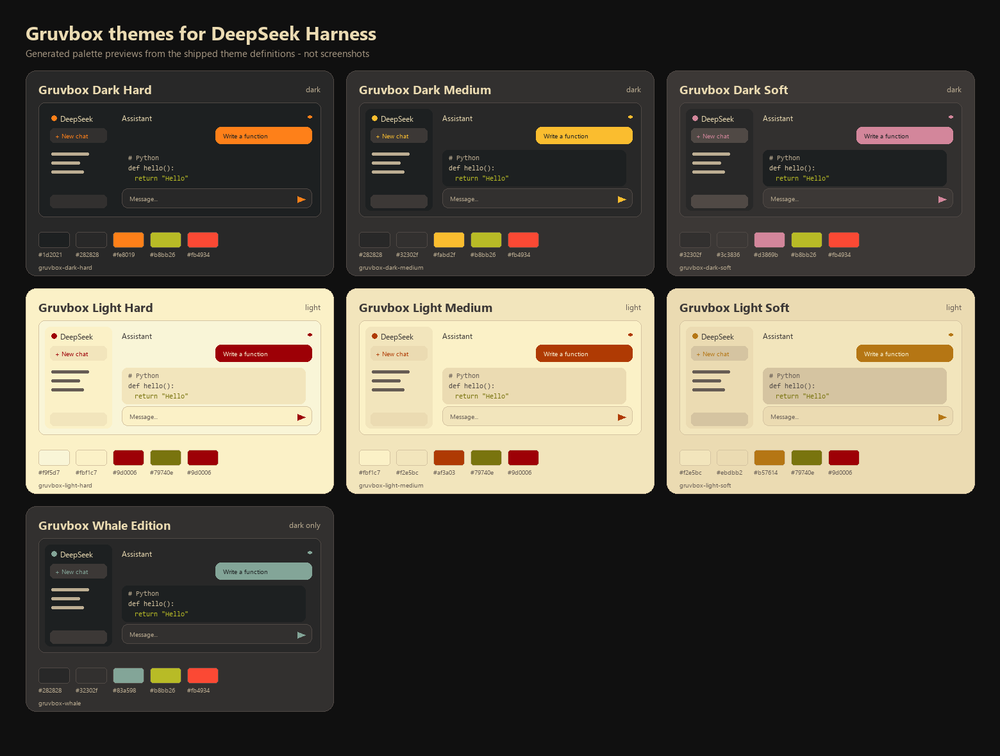

# deepseek-gruvbox-themes

Семь тем Gruvbox для [DeepSeek Harness](https://github.com/deepseek-ai/deepseek-harness): переключатель с предпросмотром в разделе **Настройки → Основные**, сохранение выбора, автоматическое следование светлой/тёмной схеме системы и небольшой инструмент для агента.



> Изображение сгенерировано из тех же данных палитры, которые регистрирует плагин. Это иллюстрация, а не снимок работающего приложения.

## Что внутри

| Идентификатор          | Схема  | Фон       | Акцент    |
| ---------------------- | ------ | --------- | --------- |
| `gruvbox-dark-hard`    | тёмная | `#1d2021` | `#fe8019` |
| `gruvbox-dark-medium`  | тёмная | `#282828` | `#fabd2f` |
| `gruvbox-dark-soft`    | тёмная | `#32302f` | `#d3869b` |
| `gruvbox-light-hard`   | светлая| `#f9f5d7` | `#9d0006` |
| `gruvbox-light-medium` | светлая| `#fbf1c7` | `#af3a03` |
| `gruvbox-light-soft`   | светлая| `#f2e5bc` | `#b57614` |
| `gruvbox-whale`        | тёмная | `#282828` | `#83a598` |

Каждая тема переопределяет **125 токенов**: фон и поверхности, сайдбар, рамки, основной и вторичный текст, бренд и кнопки, состояния наведения, успех/предупреждение/ошибку, меню, композер, скроллбары, Markdown и диффы, переменные подсветки Shiki, а также цвета терминала через `--dsw-alias-bg-base` и `--dsw-alias-label-primary`.

В настройках появляется строка **Темы Gruvbox**: карточка с предпросмотром для каждой темы (рисуется собственными цветами темы), переключатель **Следовать оформлению системы** и кнопка **Вернуть стандартную тему**.

## Совместимость и использованные API

Плагин собран и проверен на установленном **DeepSeek Harness `0.2.2-rc.1`**. Используются только документированные точки расширения:

- `ctx.theme.getTheme()`, `ctx.theme.setTheme()` и `ctx.theme.overrideTokens()` из `@deepseek-ai/dsh-client-ui-theme`;
- `ctx.configForms.get(entryId)` из `@deepseek-ai/dsh-client-ui-settings` для чтения и записи выбора;
- Host-строка с `Config` на schemastery и полями `.volatile()`, которую обслуживает служба настроек;
- `webserver/index-inject` для окраски первого кадра до запуска клиентских плагинов;
- `ctx.tools.register()` для необязательного инструмента `gruvbox_theme`.

Плагин не использует `localStorage`, не редактирует файл профиля напрямую и не меняет исходный код DeepSeek Harness.

### Почему используется слой токенов, а не новый id темы

Установленная служба тем сохраняет в `ui-theme.preference` только `light`, `dark` и `system`; сторонний id темы живёт лишь в памяти процесса. Служба также пересматривает свои настройки при обновлении документа, из-за чего сторонний id может быть заменён. Регистрация семи сторонних id привела бы к сбросу выбора при первой же записи настроек.

Поэтому плагин оставляет **встроенную базовую схему** (`light`/`dark`/`system`), а палитру Gruvbox накладывает через `ctx.theme.overrideTokens()`. Долговременный выбор (`theme` и `followSystem`) хранится в собственной записи плагина. В результате:

- цвета переживают записи настроек и перезапуск;
- `followSystem` выставляет базовую схему `system`: Host сам переключает светлое/тёмное оформление, а слой уже содержит обе палитры;
- встроенная строка «Внешний вид» продолжает работать; выбор другого значения в ней снимает слой Gruvbox.

## Установка

Плагин устанавливается через менеджер плагинов — эквивалент команды:

```sh
dsh plugin --profile desktop add ./deepseek-gruvbox-themes
```

Другие варианты:

```sh
# после публикации репозитория
dsh plugin --profile desktop add github:<owner>/deepseek-gruvbox-themes

# после публикации пакета в npm
dsh plugin --profile desktop add deepseek-gruvbox-themes
```

`web` — поставляемый профиль веб-интерфейса; подставьте своё имя профиля вместо `desktop`, если нужно. Пакет содержит манифест bundle (`dsh.bundle.patch`) и браузерную половину (`dsh.client`), поэтому `dsh plugin` подключает обе стороны.

Удаление:

```sh
dsh plugin --profile desktop remove deepseek-gruvbox-themes
```

### Ручная установка

Если профиль ведётся вручную, добавьте пакет в зависимости профиля и перезапустите Host. Патч bundle вставляет строку:

```yaml
- insert:
    - id: deepseek-gruvbox-themes
      name: deepseek-gruvbox-themes
```

## Как пользоваться

1. Откройте **Настройки** (шестерёнка внизу сайдбара).
2. Откройте **Основные** и найдите **Темы Gruvbox** сразу после встроенной строки «Внешний вид».
3. Нажмите на карточку. Приложение сразу перекрашивается, на карточке появляется кольцо и галочка.
4. Включите **Следовать оформлению системы**, чтобы переключаться между светлым и тёмным вариантом выбранного семейства при смене схемы ОС. У Whale Edition нет светлого варианта — она всегда тёмная.
5. Нажмите **Вернуть стандартную тему**, чтобы снять слой Gruvbox и вернуться к встроенной теме.

Сохранение начинается сразу после нажатия; строка показывает «Сохранение…», «Сохранено» или конкретную ошибку. Если профиль запрещает запись настроек, показывается сообщение «только для чтения», а тема действует до конца сеанса.

### Где хранится выбор

Выбор записывается в документ настроек профиля отдельной строкой плагина:

```yaml
- id: deepseek-gruvbox-themes
  name: deepseek-gruvbox-themes
  config:
    theme: gruvbox-dark-medium
    followSystem: false
```

Кроме того, фиксированная тема выставляет встроенную `ui-theme.preference` в соответствующее значение `light` или `dark`, чтобы нативные элементы и атрибут `data-ds-dark-theme` совпадали с палитрой. Режим `followSystem` выставляет `system`.

В `localStorage`, cookie или внешнем сервисе ничего не хранится.

## Инструмент для агента

Host-половина регистрирует `gruvbox_theme`:

```json
{ "action": "status" }
{ "action": "list" }
{ "action": "set", "theme": "gruvbox-dark-soft", "followSystem": true }
{ "action": "reset" }
```

`set` и `reset` пишут те же поля настроек, что и переключатель, поэтому изменение из чата доходит до подключённых веб-клиентов через документ настроек и сохраняется. Неверный id темы и профиль только для чтения возвращают явную ошибку, а не ложный успех.

## Покрытие токенов

`cordis_inspect_query` (`Theme.listTokens`) в этой сборке сообщает о 14 переопределяемых alias-токенах — все они покрыты. Дополнительно слой задаёт более широкий набор alias-токенов, который используют поставляемые стили:

- поверхности: `bg-base`, `bg-layer-1..3`, `bg-overlay`, `bg-module-platform`, `bg-skeleton`, маски, multi-select, предпросмотр документа;
- сайдбар: `specific-sidebar-fill`, `specific-sidebar-nav-item-active`, `-active-accent`;
- рамки: `border-l1..l4`, инвертированные;
- текст: основной, вторичный, третичный, подписи, приглушённый, инвертированный, shimmer;
- бренд, ссылки, кнопки (primary, contrast, elevated, floating, ghost, info, toolbar);
- взаимодействие: hover, active, акцентный и опасный hover;
- состояния: success, warning, error, idle, business, done;
- меню, toast, tooltip, переключатель, turn trigger, карточки настроек, скроллбары;
- Markdown: блок кода, баннер, инлайн-код, цитата, выделение сегмента, диффы;
- Shiki: `--shiki-foreground`, `--shiki-background` и все `--shiki-token-*`.

Терминал: боковой терминал вычисляет фон, текст, курсор и выделение из вычисленных стилей, поэтому `bg-base` и `label-primary` темы на него действуют. Таблицу ANSI-цветов задаёт сам компонент терминала (xterm), а не дизайн-токены, поэтому эти шестнадцать ANSI-цветов не меняются вместе с темой. Это ограничение Harness, а не отсутствующий токен.

## Разработка

Требования: Node.js 20+ для сборки и Node.js 22.6+ для запуска TypeScript-тестов напрямую (репозиторий собран на Node 24).

```sh
pnpm install
pnpm run typecheck
pnpm test
pnpm run build
pnpm run previews       # перегенерировать docs/previews/*.svg и галерею
pnpm run previews:png   # дополнительно собрать контактный лист через Pillow
```

`pnpm run build` создаёт два артефакта:

- `lib/index.js` — Host-половина, ESM, schemastery встроен, без runtime-зависимостей;
- `lib/client.js` — браузерная половина в формате загрузчика модулей Harness, React вынесен наружу.

Тесты проверяют якорные цвета оригинальной палитры, покрытие обязательных токенов, контраст WCAG для текста и состояний, модель выбора, сборку светлого/тёмного слоя и строки инъекции до запуска плагинов.

### Структура проекта

```
src/shared/     палитра, определения тем, правила выбора, boot-инъекция
src/host/       Config, политика настроек, инъекция в index, инструмент gruvbox_theme
src/client/     слой override, сохранённый выбор, строка выбора, стили, локаль
test/           unit-тесты на node:test
scripts/        сборка esbuild, SVG-превью, PNG-контактный лист
docs/previews/  сгенерированные превью
```

## Известные ограничения

- **Визуальная проверка в этом окружении недоступна.** Инструмента управления браузером здесь нет, поэтому отрисовка строки и живая смена цветов проверены через зарегистрированную запись слота, применённые значения настроек, инструмент агента и сгенерированные превью, а не через скриншот. Откройте «Настройки → Основные» один раз, чтобы увидеть строку.
- Плагин меняет встроенную настройку «Внешний вид» под выбранную схему. Выбор другого значения во встроенной строке снимает тему Gruvbox; переключатель тогда показывает стандартную тему.
- Другой плагин, который накладывает более поздний слой токенов, может перекрыть этот слой: порядок слоёв принадлежит службе тем, а не этому плагину.
- Удалённым браузерам Host может запретить запись настроек; строка сообщает об этом и сохраняет выбор только на сеанс.
- Whale Edition по замыслу только тёмная.

## Лицензия

MIT. См. [LICENSE](LICENSE).

Цвета Gruvbox взяты из палитры [morhetz/gruvbox](https://github.com/morhetz/gruvbox) под лицензией MIT. Проект не связан с сопровождающими Gruvbox или DeepSeek.
